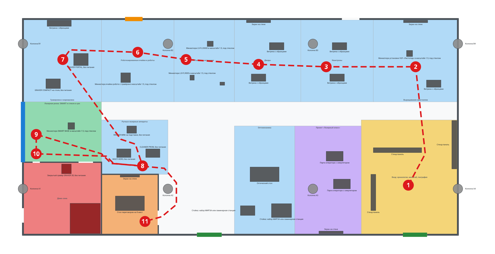
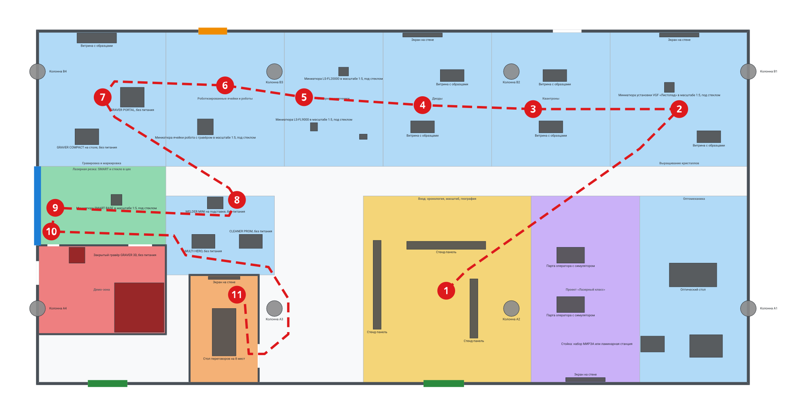

# 01. Планировочное решение: зонирование зала 219

Задачи #23, #91, #263. Дата: 24.10.2026. План зала — `content/plan-219.json` (цех слева, за `w_west`)
и `content/plan-219-mirror.json` (цех справа, файл отражён). Зонирование —
`content/plan-219-zoned.json` и `content/plan-219-mirror-zoned.json`. Файлы зонирования
пишет и проверяет `scripts/plan_zones.py`. Нормы — `concept/05-safety.md`.

План построен по D-001: в шоуруме нет луча. Крупных станков в полный размер в зале нет.

## 0. Как читать

- Оси: X вправо, Y вверх, метры. Зал 36 × 17,85 м по осям стен. Площадь кейса — 626 м²
  (`task/case.md`, слайд 6). В расчётах берём 626 м².
- Колонны: 2 ряда по 4, x = 0, 12, 24, 36; y = 3,8 и 15,8; сечение 0,8 м
  (`content/plan-219.json`). Колонны x = 0 и x = 36 стоят в стенах.
- Сторону цеха выбираем сами. Площадь новая, планировка свободная, учитываем только
  колонны; место шоурума отведено (эксперт ЛАССАРД, чат кейса 24.10, `docs/questions-for-experts.md`).
- Решение: цех за левой стеной схемы (`w_west`, основной вариант). Причины: стен демо-зоны
  в зал 12,5 м против 17,5 м, преграда меньше на 35 м²; стекло в цех 5 м против 4 м
  (раздел 4). Зеркало (раздел 7) — запасной план, если ЛАССАРД поставит цех справа.
- Размеры экспонатов — из `research/notes/lassard_facts.md` (раздел 2) или с меткой
  «оценка». Источник каждого размера — поле `provenance` в `catalog.objectTypes` файла
  зонирования.
- Миниатюра 1:5: модель — одна пятая официального размера. Если размера нет, модель —
  одна пятая оценки. Подиум 0,9 м со стеклянным колпаком: на плане — модель плюс 0,1 м с
  каждой стороны (оценка). Размеры — в разделе 2.
- Все площади, проходы и пути в этом разделе — вывод `scripts/plan_zones.py` (раздел 9).





Легенда. Красная пунктирная линия и номера — маршрут потенциального клиента (раздел 3).
Зелёные отрезки — подтверждённые выходы. Оранжевый — перечёркнутая дверь, кандидат в выход
[СПРОСИТЬ]. Синий — светопрозрачная перегородка в цех. Красная зона — демо-зона.
Красная линия на рисунке кончается у переговорной: шаг 12 (оптомеханика и «Лазерный класс») на рисунке не нарисован.

## 1. Решение коротко

- Вдоль верхней стены идёт полоса «Путь станка»: зоны 1–6 слайда 3 от кристаллов до
  гравировки. Полоса глубиной 6,85 м занимает всю длину зала.
- Вход — у правого нижнего выхода. Гость идёт к кристаллам и дальше по полосе к стене цеха.
- У стены цеха — ручные аппараты, затем миниатюра SMART BASE и стекло в цех. Это
  кульминация маршрута. Живую резку гость видит в цехе, не в зале.
- В углу у стены цеха — демо-зона. В ней луча нет. Гость отдаёт образец в окно передачи.
  Внутрь он не входит.
- Переговоры в переговорной рядом с демо-зоной — последняя содержательная остановка.
  После них гость проходит оптомеханику и «Лазерный класс» по пути к главному входу.
- Луча в зале нет (D-001): ни резки, ни гравировки, ни чистки, ни сварки. SMART BASE,
  «Листопад», LS-FL9000, LS-FL20000, Nd:YAG и ячейка робота — миниатюры 1:5 под стеклом.
  Видео работы станков 1:1 идёт в гиде. Ручные аппараты и гравёры стоят без питания.
- Оптомеханика и «Лазерный класс» (остановки по запросу, без номера в колоде) стоят в нижней части зала. Это шаг 12
  маршрута клиента: короткие боковые остановки по пути к главному входу (раздел 3).
- Пять внутренних перегородок схемы убраны (раздел 10). Новые стены: демо-зона и
  переговорная.

## 2. Зоны

Основной вариант. Площадь — по прямоугольнику зоны на плане. «Шаг» — номер на маршруте
клиента (раздел 3). «—» — зона не на маршруте клиента.

| id | Зона | Слайд 3, строка | Шаг | Площадь, м² | Класс | Что стоит |
|---|---|---|---|---|---|---|
| entrance | Вход: хронология, масштаб, география | — | 1 | 76,0 | Ф2.2 | 3 стенд-панели: хронология с 2015 года, карта поставок, числа масштаба |
| crystals | Выращивание кристаллов | 1 | 2 | 47,95 | Ф2.2 | миниатюра «Листопад» 1:5 под стеклом, витрина с подложками, экран с видео выращивания |
| quantrons | Квантроны | 2 | 3 | 41,1 | Ф2.2 | 2 витрины |
| diodes | Диоды | 3 | 4 | 37,68 | Ф2.2 | 2 витрины, экран |
| laser_sources | Лазерные источники | 4 | 5 | 34,25 | Ф2.2 | миниатюры LS-FL9000, LS-FL20000 и Nd:YAG, 1:5, под стеклом |
| robots | Роботизированные ячейки и роботы | 5 | 6 | 41,1 | Ф2.2 | миниатюра ячейки робота с гравёром, 1:5, под стеклом |
| engraving | Гравировка и маркировка | 6 | 7 | 44,53 | Ф2.2 | GRAVER COMPACT, GRAVER PORTAL (без питания), витрина образцов |
| handheld | Ручные лазерные аппараты | 8 | 8 | 24,75 | Ф2.2 | MULTI HERO, CLEANER PROM, WELDER MINI (без питания, ключ снят) |
| cutting | Лазерная резка: SMART и стекло в цех | 7 | 9 | 32,5 | Ф2.2 | миниатюра SMART BASE 1:5 под стеклом, точка у стекла в цех |
| test_lab | Демо-зона | — | 10 | 39,0 | [СПРОСИТЬ] | GRAVER 3D без питания, ограждённый участок без луча; вывеска «ДЕМО-ЗОНА · ЛУЧА НЕТ» |
| meeting | Переговорная | — | 11 | 23,5 | Ф2.2 | стол на 8 мест, экран |
| optomechanics | Оптомеханика | 9 | 12 | 45,0 | Ф2.2 | оптический стол, стойки МИРЭА и ламинарной станции |
| edu_class | Проект «Лазерный класс» | 10 | 12 | 49,5 | Ф2.2 | 2 парты оператора с симулятором, экран |

Сумма площадей зон: 536,86 м². Это меньше 626 м². Остаток 89,14 м² — проходы между зонами.

Миниатюры 1:5 в зале. Размеры — по плану, метры (`catalog.objectTypes`, `ot_*`). Подиум —
0,9 м, дальше стеклянный колпак. Высота — до верха колпака.

| Объект | Зона | Модель, мм | На плане, Ш × Г × В, м | Источник модели |
|---|---|---|---|---|
| «Листопад» (VGF) | crystals | 300 × 300 × 500 | 0,5 × 0,5 × 1,5 | оценка: габарит установки не опубликован |
| LS-FL9000 | laser_sources | 160 × 220 × 240 | 0,36 × 0,42 × 1,24 | 1/5 от 800 × 1100 × 1200 мм, официально |
| LS-FL20000 | laser_sources | 300 × 240 × 324 | 0,5 × 0,44 × 1,32 | 1/5 от 1500 × 1200 × 1620 мм, официально |
| Nd:YAG | laser_sources | 187 × 59 × 30 | 0,39 × 0,26 × 1,03 | 1/5 от лазера 933 × 296 × 149 мм, официально |
| Ячейка робота с гравёром | robots | 600 × 600 × 440 | 0,8 × 0,8 × 1,44 | оценка: габарит ячейки не опубликован |
| SMART BASE | cutting | 350 × 350 × 440 | 0,55 × 0,55 × 1,44 | 1/5 от 1750 × 1750 × 2200 мм, официально |

- Поле SMART BASE 800 × 800 мм — не габарит станка (TRAP-3). Миниатюру считаем от
  1750 × 1750 × 2200 мм.
- Позиции на плане остались от прежней расстановки. Площади зон не менялись. Место,
  которое занимали станки в полный размер, стало проходом и запасом площади.
- Видео 1:1 на плане не нанесено: нет объектов «видеостенд». Видео работы станков идёт в
  гиде на телефоне гостя. Видеостенд на стене — решение лида.
  Размеры настоящих миниатюр и видео — у ЛАССАРД [СПРОСИТЬ].

Решения по составу:

- Луча в зале нет (D-001). Резки, гравировки, чистки и сварки в зале нет. Вытяжки и кабин
  в зале нет.
- Зона `cutting` — миниатюра SMART BASE 1:5 и точка у стекла в цех. Станок в полный
  размер в зале не стоит. Живую резку гость видит в цехе через стекло. Виден ли станок от
  стекла — [СПРОСИТЬ] эксперта (`05-safety.md`, 3.5). Если не виден, показ идёт на экране.
- LEADER (10,2 м) в зале не ставим. Проверка колонн для LEADER не нужна.
- Ручные аппараты и гравёры стоят без питания, ключ снят (`05-safety.md`, 3.4). Рядом —
  образцы и видео работы.
- Ячейка робота — миниатюра 1:5 без лазера. Работу ячейки показывает видео 1:1.
- Id зон — id контракта зон из брифа #23. Id `laser_class` нет. Зона 10 — `edu_class`.

## 3. Маршрут потенциального клиента

Порядок: вход → кристаллы → квантроны → диоды → лазерные источники → роботы → гравировка →
ручные аппараты → миниатюра SMART BASE и стекло в цех → демо-зона → переговорная →
боковые остановки (оптомеханика, «Лазерный класс») по пути к выходу.

- Шаги 2–5 — цикл компонентов (зоны 1–4). Они идут раньше всех зон станков (5–8).
- Шаги 6–9 — оборудование. В зале это миниатюра ячейки, гравёры и ручные аппараты без
  питания, миниатюра SMART BASE. Гравировка стоит у стены цеха. От неё маршрут
  поворачивает вниз к ручным аппаратам и к стеклу.
- Шаг 9 — кульминация. Гость стоит у стекла в цех. Ширина стекла 5 м (оценка), на стене
  `w_west`, y = 6–11 м. Рядом — миниатюра SMART BASE.
- Шаг 10 — окно передачи образцов на северной стене демо-зоны. Гость отдаёт образец
  менеджеру и потом получает его назад. Образец режут в цехе (`04-zones.md`, «Демо-зона»).
  В демо-зону гость не входит.
- Шаг 11 — переговорная. Её дверь открыта в зал с восточной стороны.
- Порядок шагов 6–9 отличается от порядка строк слайда 3: «Резка» (строка 7) стоит после
  «Ручных аппаратов» (строка 8). Причина: точка у стекла — финал экспозиции.
- Шаг 12 — боковые остановки: оптомеханика и «Лазерный класс». Они стоят
  на плане правее переговорной (x 17,5–28 м), по пути к главному входу `op_south_2`
  (x 31,45–33,45 м). Гость идёт к ним от переговорной на восток и не возвращается к стеклу.
  Маршруты для других ролей задаёт `content/routes.json`.

## 4. Демо-зона

| Параметр | Основной вариант | Зеркало |
|---|---|---|
| Место | угол у стены цеха и нижней стены, x = 0–6,5, y = 0–6 | у стены цеха, x′ = 0–6,5, y = 2,5–7 |
| Размер | 6,5 × 6,0 м, 39 м² | 6,5 × 4,5 м, 29,25 м² |
| Стены в зал | `w_lab_n` 6,5 м + `w_lab_e` 6,0 м = 12,5 м | `w_lab_s` 6,5 + `w_lab_n` 6,5 + `w_lab_e` 4,5 = 17,5 м |
| Соседи за стенами | `w_lab_n` — зона резки; `w_lab_e` — переговорная (y = 0–5) и ручные аппараты (y = 5–6) | `w_lab_n` — зона резки; `w_lab_s` — проход у выхода `op_south_2`; `w_lab_e` — проход к переговорной и ручные аппараты (y = 5,5–7) |
| Высота стен | 7 м, до потолка | 7 м |
| Дверь в зал | 1,2 м, только персонал | 1,2 м |
| Выход в цех | дверь 1,2 м на `w_west` — не подтверждён [СПРОСИТЬ] | дверь 1,2 м на стене цеха — не подтверждён |
| Окно передачи образцов | 0,6 м, подоконник 0,9 м, на `w_lab_n`; E 30 | 0,6 м, на `w_lab_n`; E 30 |

- Луча в демо-зоне нет (D-001). Вывеска — «ДЕМО-ЗОНА · ЛУЧА НЕТ» (`02-visual.md`, кадры 3D). Лазерной
  кабины, лазерозащитного стекла и блокировки лазера нет (`05-safety.md`, 3.5).
- Класс демо-зоны — [СПРОСИТЬ] (IR630). В `05-safety.md` раздел 2 принят Ф5.1 до ответа
  (допущение, вопрос 17). Поэтому стены в зал закладываем как светопрозрачную
  противопожарную преграду EIW 45 без лазерного слоя (`05-safety.md`, 3.5 и 4.4). Если
  класс зала и зоны один, преграда не нужна.
- Окно передачи образцов стоит в преграде EIW 45. Окно — противопожарное, не ниже E 30
  (тип 2; `05-safety.md` 3.5, 123-ФЗ табл. 23 и 24: окна E 60 / E 30 / E 15 для типов 1 / 2 / 3, сверено 25.10.2026). Блокировка лазера на
  створке не нужна: лазера в зоне нет.
- Внутри по плану: GRAVER 3D без питания (0,8 × 0,8 м, оценка) и ограждённый участок без
  луча (2,5 × 2,5 м, оценка). Что стоит за ограждением — [СПРОСИТЬ] эксперта ЛАССАРД.
  `04-zones.md` («Демо-зона») называет другой состав: один движущийся образец под стеклом,
  без луча, без гравёра. До ответа эксперта план держит гравёр и ограждённый участок как
  места под образец.
- Выходы. Дверь в зал есть всегда. Выход в цех не подтверждён (`05-safety.md`, 4.3). Если
  выход один и он в зал, путь персонала идёт через зал Ф2.2 (правило п. 4.2.8, не больше 50 % выходов через одно соседнее помещение). Вопрос проектировщику.
- Путь персонала от дальней точки демо-зоны до выхода из зала: 21,4 м (основной), 17,3 м
  (зеркало). Путь идёт через дверь в зал.
- Смета (`content/estimate.json`, `concept/06-rationale.md`) считает основной вариант:
  зона 6,5 × 6,0 м = 39 м², стен в зал 12,5 м, преграда 12,5 × 7 = 87,5 м². В зеркале
  стен в зал 17,5 м, преграда 122,5 м²: смета вырастет на 35 м² преграды. Лазерный слой
  на стенах демо-зоны не нужен; смету по этому правилу ведёт #166.
- Стекло в цех на плане: 5 × 3,5 м = 17,5 м² (основной) и 4 × 3,5 м = 14 м² (зеркало).
  Ширина и высота — оценка. За этим стеклом работает лазер цеха, поэтому
  лазерный слой остаётся (`05-safety.md`, 3.5). Смета берёт 17,5 м² EIW и 17,5 м² лазерного слоя.

## 5. Проходы и колонны

- Норма прохода: 1,0 м; 1,2 м при числе эвакуируемых больше 50 (СП 1.13130.2020, п. 4.3.3,
  `05-safety.md` 4.2; текст п. 4.3.3 сверен 25.10.2026). Вместимость зала — 90 человек
  (`05-safety.md` 4.2). Поэтому в зале каждый проход — путь эвакуации, норма 1,2 м.
- Исключение — переговорная (8 мест) и демо-зона (только персонал). Из них эвакуируются
  не больше 50 человек. Норма внутри них — 1,0 м.
- Проверка: зазор между двумя экспонатами, между экспонатом и колонной и между экспонатом
  и стеной. В зале — не меньше 1,2 м, в переговорной и демо-зоне — не меньше 1,0 м.
  Экспонат ближе 0,1 м к стене стоит у стены: прохода за ним нет. Экран на стене — часть
  стены. Нарушений: 0 в обоих вариантах. Тест ловит проход 1,1 м (`tests/test_layout.py`).
- Чтобы получить 1,2 м, сдвинуты экспонаты. Оба варианта: витрина с образцами у правой
  стены в зоне кристаллов. Основной: стенд хронологии (от колонны A4), ручные аппараты,
  гравёр и ограждённый участок в демо-зоне. Зеркало: стенды входа, стенд масштаба (от колонны A2),
  стойка оптомеханики, ручные аппараты, миниатюра SMART BASE, гравёр и ограждённый участок в демо-зоне.
- Основной продольный проход — полоса y = 9,5–11 м между «Путём станка» и нижними зонами.
  Ширина 1,5 м по границам зон. По экспонатам проход шире.
- Пересечений экспонатов с колоннами: 0. Пересечений экспонатов со стенами: 0. Пересечений
  зон: 0.
- Внутренние колонны стоят в зонах или в проходах. Основной вариант: A2 — в проходе, A3 —
  в «Лазерном классе», B2 — в зоне роботов, B3 — в зоне квантронов. Экспонаты стоят от
  колонн не ближе 1,2 м.
- Свободная зона 1,2 м перед каждым выходом: экспонатов в ней нет.

## 6. Выходы и путь до выхода

| Выход | Ширина | Статус |
|---|---|---|
| `op_south_1` | 2,05 м | подтверждён (нижняя стена схемы) |
| `op_south_2` | 2,0 м | подтверждён; главный вход основного варианта |
| `op_north_1`, `op_north_2` | 1,45 м | перечёркнуты на схеме; можно ли открыть — [СПРОСИТЬ] |

- Выходов из зала два. Каждый шире 1,2 м (п. 4.2.19, 7.1.6). Это выполняет S3 п. 6.
- **Находка.** Расстояние между двумя подтверждёнными выходами — 15,0 м. Норма — не меньше
  половины диагонали, 20,09 м (п. 4.2.16, `05-safety.md` 4.2). Норма не выполнена.
  Выходы в нижней стене даёт схема. Решение — у владельца здания:
  - открыть перечёркнутую дверь в верхней стене: тогда расстояние 27,98 м (основной,
    `op_north_1`) или 20,44 м (зеркало, `op_north_2`);
  - или сделать новую дверь дальше от второго выхода.
- Как меряем: между ближними краями проёмов, вдоль нижней стены, основной вариант
  (п. 4.2.16: расстояние между ближайшими гранями выходов не меньше половины наибольшей диагонали помещения; сверено 25.10.2026). Ближние края: x = 16,45 и x = 31,45,
  расстояние 15,0 м. Дальние края: 19,05 м. Оба числа меньше 20,09 м. Поэтому вывод не
  зависит от способа замера.
- Вопрос о двери и классе здания — организаторам (`docs/questions-for-organizers.md`).
- Путь до ближайшего выхода. Сетка 0,2 м, обход экспонатов и колонн с запасом 0,3 м.

| Случай | Основной | Зеркало |
|---|---|---|
| Два подтверждённых выхода | 24,1 м (угол гравировки) | 23,0 м (угол кристаллов) |
| Плюс одна верхняя дверь | 18,9 м | 23,0 м |
| Плюс обе верхние двери | 14,6 м | 16,0 м |
| Открыт только `op_south_1` | 27,1 м | 26,9 м |
| Открыт только `op_south_2` | 38,5 м | 40,3 м |

- Какая норма действует. Зал Ф2.2, объём до 5 тыс. м³ (табл. 5). Класс здания С0 — 30 м,
  С1 — 20 м. Класс здания неизвестен [СПРОСИТЬ]. План выполняет 30 м (С0). План не
  выполняет 20 м (С1) без верхних дверей.
- При классе С1 нужны обе верхние двери, или одна в основном варианте.
- Строки «открыт только один выход» — справка. Норма п. 4.2.17 про блокировку выхода
  проверяет ширину, а не длину пути.
- Путь посетителя не идёт через демо-зону и цех.

## 7. Запасной вариант: зеркало

- Нужен, если ЛАССАРД поставит цех справа. Маршрут и проверки те же, смета выше (раздел 4).

- Цех за правой стеной схемы. Файл `content/plan-219-mirror-zoned.json` отражён: x′ = 36 − x.
  Стена цеха в файле — `w_east` при x = 0. Стена `w_west` лежит справа, x = 36.
- Полоса «Путь станка» та же. Гравировка снова у стены цеха.
- Главный вход — `op_south_1`. Входная зона x′ = 16,5–25.
- Демо-зона отходит от нижней стены (y = 2,5–7). Причина: выход `op_south_2` (x′ = 2,55–4,55)
  в нижней стене у стены цеха. Перед ним нужна свободная зона.
- Стекло в цех — 4 м (оценка), y = 7–11 м.
- Оптомеханика и «Лазерный класс» — справа внизу.
- Порядок маршрута тот же. В зеркале гость идёт к оптомеханике и «Лазерному классу» мимо `op_south_1` и возвращается
  примерно на 12 м. Выходов два. Все проверки раздела 9 проходят.

## 8. Галерея над цехом (+3,5 м)

**Рекомендация: галерею не закладываем.** Это рекомендация, решение — у лида (#9).

- Норма: антресоль с одним выходом — не больше 300 м² и не больше 20 человек
  (п. 7.1.12, `05-safety.md` 4.6). Иначе нужны две лестницы.
- Группа S3 — 30 человек. Это больше 20.
- Плана цеха нет. Где поставить две лестницы, неизвестно.
- Стекло в цех даёт вид на цех с пола зала. Галерея нужна только для вида сверху.
- Запасной вариант, если организаторы подтвердят: лимит 20 человек и одна лестница.

## 9. Проверки

Команда: `python3 scripts/plan_zones.py --check`. Код возврата 0 — все проверки прошли.
Скрипт также сверяет файлы с генератором. Строка «confirmed ok: False» — находка раздела 6,
не ошибка проверки. Вывод на 24.10.2026:

```
[original] zones 13, ids = contract: True; route order ok: True
  zone area sum 536.86 m2 <= hall 626.0 m2: True
  areas: entrance 76.0, crystals 47.95, quantrons 41.1, diodes 37.68, laser_sources 34.25, robots 41.1, engraving 44.53, cutting 32.5, handheld 24.75, optomechanics 45.0, edu_class 49.5, meeting 23.5, test_lab 39.0
  zone overlaps 0, outside room 0, objects outside zone 0
  column clashes 0, wall clashes 0, passages < 1.2 m (hall) / 1.0 m (meeting, demo zone): 0, blocked exit approaches 0
  exit widths: op_south_1 2.05 m, op_south_2 2 m, op_north_1 1.45 m (min 1.2)
  exit spacing (near edges): confirmed 15.0 m (far edges 19.05 m), with op_north_1 27.98 m; half diagonal 20.09 m -> confirmed ok: False
  max path to exit (hall, 2 confirmed exits): 24.1 m from [0.5, 17.3] (engraving); C0 <= 30.0: True; C1 <= 20.0: False
  only one exit open: op_south_1 27.1 m, op_south_2 38.5 m
  with op_north_1: hall 18.9 m; with both north doors: hall 14.6 m; test_lab staff to a hall exit: 21.4 m; unreachable cells 0
[mirror] zones 13, ids = contract: True; route order ok: True
  zone area sum 528.36 m2 <= hall 626.0 m2: True
  areas: entrance 80.75, crystals 47.95, quantrons 41.1, diodes 37.68, laser_sources 34.25, robots 41.1, engraving 44.53, cutting 26.0, handheld 22.0, optomechanics 52.25, edu_class 52.25, meeting 19.25, test_lab 29.25
  zone overlaps 0, outside room 0, objects outside zone 0
  column clashes 0, wall clashes 0, passages < 1.2 m (hall) / 1.0 m (meeting, demo zone): 0, blocked exit approaches 0
  exit widths: op_south_1 2.05 m, op_south_2 2 m, op_north_2 1.45 m (min 1.2)
  exit spacing (near edges): confirmed 15.0 m (far edges 19.05 m), with op_north_2 20.44 m; half diagonal 20.09 m -> confirmed ok: False
  max path to exit (hall, 2 confirmed exits): 23.0 m from [35.5, 17.3] (crystals); C0 <= 30.0: True; C1 <= 20.0: False
  only one exit open: op_south_1 26.9 m, op_south_2 40.3 m
  with op_north_2: hall 23.0 m; with both north doors: hall 16.0 m; test_lab staff to a hall exit: 17.3 m; unreachable cells 0
```

- Тесты: `tests/test_layout.py`, 28 тестов. Есть отрицательные тесты на каждую ловушку:
  экспонат на колонне, пересечение зон, проход 1,1 м в зале, проход у стены, узкий выход,
  экспонат перед выходом, сумма площадей больше зала, один выход, нет выходов. Ещё 4 теста
  проверяют линию маршрута: она не пересекает экспонаты и стены, номера остановок не
  закрывают экспонаты и подписи. Ещё 2 теста (`D001PlanTest`) проверяют D-001: в текстах
  плана нет «работает», «вживую» и «допуск»; крупное оборудование стоит только миниатюрой 1:5.
- Совместимость с планировщиком pochta (PlanDocument v1). Команда:
  `python3 scripts/plan_png.py --validate`. pochta — соседний репозиторий
  `../tsifrovoy-dvoynik-otdeleniya-pochty-rossii` (или `POCHTA_DIR`), коммит
  `f15ba315efc069aec2a0a18c9f68e4829ff61cb7`, только чтение. Вывод на 24.10.2026:

```
pochta /home/chichetin/PycharmProjects/tsifrovoy-dvoynik-otdeleniya-pochty-rossii commit f15ba315efc069aec2a0a18c9f68e4829ff61cb7
[original] content/plan-219-zoned.json
error OBJECT_OUTSIDE_ROOM Объект «Колонна A1» выходит за границы помещения.
error OBJECT_OUTSIDE_ROOM Объект «Колонна A4» выходит за границы помещения.
error OBJECT_OUTSIDE_ROOM Объект «Колонна B1» выходит за границы помещения.
error OBJECT_OUTSIDE_ROOM Объект «Колонна B4» выходит за границы помещения.
error OBJECT_HITS_WALL Объект «Колонна A1» пересекает наружную стену.
error OBJECT_HITS_WALL Объект «Колонна A4» пересекает наружную стену.
error OBJECT_HITS_WALL Объект «Колонна B1» пересекает наружную стену.
error OBJECT_HITS_WALL Объект «Колонна B4» пересекает наружную стену.
warning ZONE_UNASSIGNED Объект «Колонна A1» не лежит целиком ни в одной зоне.
warning ZONE_UNASSIGNED Объект «Колонна A2» не лежит целиком ни в одной зоне.
warning ZONE_UNASSIGNED Объект «Колонна A4» не лежит целиком ни в одной зоне.
warning ZONE_UNASSIGNED Объект «Колонна B1» не лежит целиком ни в одной зоне.
warning ZONE_UNASSIGNED Объект «Колонна B4» не лежит целиком ни в одной зоне.
decode ok; issues 13
[mirror] content/plan-219-mirror-zoned.json
error OBJECT_OUTSIDE_ROOM Объект «Колонна A1» выходит за границы помещения.
error OBJECT_OUTSIDE_ROOM Объект «Колонна A4» выходит за границы помещения.
error OBJECT_OUTSIDE_ROOM Объект «Колонна B1» выходит за границы помещения.
error OBJECT_OUTSIDE_ROOM Объект «Колонна B4» выходит за границы помещения.
error OBJECT_HITS_WALL Объект «Колонна A1» пересекает наружную стену.
error OBJECT_HITS_WALL Объект «Колонна A4» пересекает наружную стену.
error OBJECT_HITS_WALL Объект «Колонна B1» пересекает наружную стену.
error OBJECT_HITS_WALL Объект «Колонна B4» пересекает наружную стену.
warning ZONE_UNASSIGNED Объект «Колонна A1» не лежит целиком ни в одной зоне.
warning ZONE_UNASSIGNED Объект «Колонна A3» не лежит целиком ни в одной зоне.
warning ZONE_UNASSIGNED Объект «Колонна A4» не лежит целиком ни в одной зоне.
warning ZONE_UNASSIGNED Объект «Колонна B1» не лежит целиком ни в одной зоне.
warning ZONE_UNASSIGNED Объект «Колонна B4» не лежит целиком ни в одной зоне.
decode ok; issues 13
```

- Оба файла декодируются. Ошибки — только ложные для колонн в стенах (A1, A4, B1, B4):
  колонна стоит в стене по схеме. Предупреждения ZONE_UNASSIGNED — для колонн в проходах и
  на границах зон.
- Картинки `concept/img/plan-219*-zoned.png` рисует `python3 scripts/plan_png.py`. Основа —
  рендер pochta (тот же коммит). Поверх скрипт рисует маршрут, выходы и стекло. Линия
  маршрута — кратчайший путь по сетке 0,2 м с запасом 0,3 м от экспонатов, колонн и стен
  (`route_line` в `scripts/plan_zones.py`). Номер остановки не закрывает подписи pochta. Нужны `tsx` из pochta и `rsvg-convert`. Без
  pochta скрипт завершается с кодом 2 и пишет, чего нет. `make check` его не вызывает.

## 10. Что изменено на схеме

- Убраны 5 внутренних перегородок схемы: `w_part_v1`–`w_part_v3`, `w_part_h1`, `w_part_h2`.
  Слайд 6 разрешает убрать их.
- Новые стены: демо-зона и переговорная, обе 7 м, до потолка. Стенды-панели входа (история,
  карта, масштаб) тоже 7 м: так виден масштаб компании (#185, эксперт ЛАССАРД, ЧП2). Дверь переговорной
  открывается наружу.
- Новые проёмы: стекло в цех, дверь демо-зоны в зал, выход демо-зоны в цех (не
  подтверждён), окно передачи образцов (без блокировки лазера), дверь переговорной.
- Контур зала и проёмы схемы не меняли.

## 11. Открытые вопросы

- [СПРОСИТЬ] Класс конструктивной пожарной опасности здания: С0 или С1?
- [СПРОСИТЬ] Можно ли открыть перечёркнутые двери в верхней стене как выходы?
- [СПРОСИТЬ] Класс демо-зоны и её выход в цех.
- [СПРОСИТЬ] Демо-зона: что стоит за ограждением и что показывает движущийся образец.
  Нужен ли GRAVER 3D без питания.
- [СПРОСИТЬ] Миниатюры 1:5 и видео 1:1: что есть у ЛАССАРД и каковы настоящие размеры.
- [СПРОСИТЬ] Почему площадь по осям стен (642,6 м²) больше 626 м²? При стенах 0,15 м площадь
  внутри стен — 634,5 м² (оценка). Это тоже больше 626 м².
