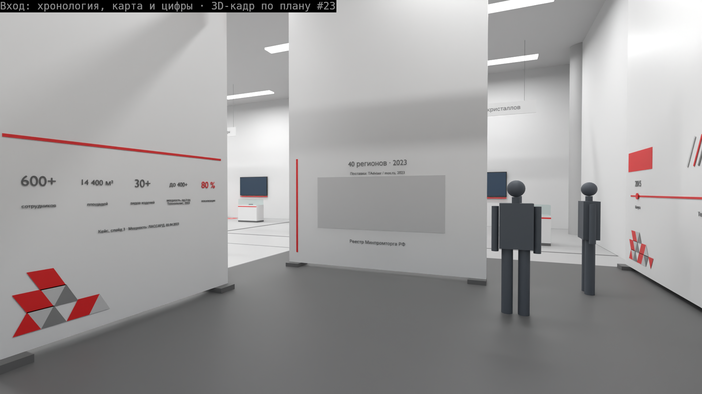

# 02. Визуализация: кадры 3D зала 219 и промпты ИИ-рендера

Задачи #27 и #96. Дата: 24.10.2026. Критерии жюри: «Визуализация» и «Планировочное
решение» (`task/case.md`, слайд 16).

Статус: **по плану #23**. Зоны, объекты, стены и проёмы скрипт берёт из
`content/plan-219-zoned.json` (#23, #91). Цех стоит за стеной w_west, как в плане.
#91 ещё двигает стенды под проходы 1,2 м. После правки плана одна команда пересобирает
все кадры (раздел 3).

## 0. Как читать

| Метка | Что значит |
|---|---|
| План | `content/plan-219-zoned.json`: контур 36 × 17,85 м, высота 7 м, 13 зон, 32 объекта, 8 колонн, стены демо-зоны и переговорной, проёмы |
| Зоны | `concept/01-layout.md`, раздел 2: id зоны, номер строки слайда 3, шаг маршрута |
| Р-Ф | `research/notes/lassard_facts.md`, §2–4 (каталог ЛАССАРД 2026, lassard.ru) |
| оценка | размера в источниках нет. Это допущение команды |
| [СПРОСИТЬ] | вопрос эксперту ЛАССАРД (раздел 7) |

Правила кадра:

- Кадр 3D — геометрия из плана и прокси оборудования. Прокси — простая форма с внешним
  габаритом объекта плана. Это не модель изделия.
- В каждом кадре есть фигура человека ростом 1,75 м.
- Подпись в каждом кадре: «<вид> · 3D-кадр по плану #23». Подпись стоит на непрозрачной
  тёмной плашке вверху кадра.
- Имя компании — ЛАССАРД или LASSARD. Превосходных степеней нет. «100 %» нет.
- Цвета — брендбук: #DD191C, #606060, белый (`task/brandbook.md`, палитра, с. 27). На стенде
  хронологии — паттерн треугольников и линии под 243°.
- Стиль экспозиции — раздел 0.1.
- Красная пунктирная рамка на полу — только у зоны испытаний (граница зоны, не знак «работает»).
  Рамка зон 1–4 слайда 3 — тёмно-серая, рамка остальных зон — серая.

## 0.1. Стиль экспозиции (эксперт ЛАССАРД, чек-поинт 2, 24.10.2026, 13:03)

Источник: запись чек-поинта 2, 11:22–12:29 (#189). Правила:

1. **Вертикальные членения.** Фирстиль называет первой чертой «вертикальное членение
   панелей» (`task/brand.md`, слайд 1, п. 1). Стенды, подиумы и фризы делим вертикальными
   полосами. Во 3D стены несут красные вертикальные полосы шириной 0,06 м с шагом 0,6 м
   (допущение команды: размеры в брендбуке не заданы).
2. **Скошенные формы.** «Скошенные углы и трапециевидные выемки со скосами»
   (`task/brand.md`, слайд 1, п. 4). Формообразование стенда повторяет станок
   (`task/brand.md`, слайд 2, п. 1): углы, цоколи и стойки скошены. Стойки-штандарты
   с названием изделия стоят у станков (слайд 2, п. 3).
3. **Фон экспозиции — белый, акцент — красный.** Эксперт ЛАССАРД 24.10 вечером
   уточнил правило чек-поинта 2 (`research/notes/expert-call-2026-10-24.md`, 05:58–06:26):
   основа — белый и красный; серый — только технические места (пол, цоколи, опоры);
   чёрный — крайне изолированно, гендиректор его не любит. Стены, потолок, панели,
   экраны и графика зон — белые. Красный #DD191C — полосы, фризы, рабочие зоны станков
   (`task/brand.md`, слайд 1, п. 3). Тёмно-серый #606060 — только мелкие технические детали.
4. **Презентация — иначе.** Белый фон и красный акцент. Тёмных слайдов нет. Серый — только
   в мелком тексте и плашках.

Планировщик: `web/src/planner/colors.ts` (`BRAND_DARK_GREY`, `BRAND_RED`) и
`web/src/planner/scene.ts` (полосы). Планировщик ещё тёмно-серый (#606060): его стены — правка
по правилу 3. Кадры Blender v4 (белый стиль) — релиз `renders-v4` на GitHub.

### 0.2. Философия зала: путь героя в трёх актах (предложение, ждёт «да» человека)

Суть бренда — «БЫСТРЕЕ! ВЫШЕ! УМНЕЕ!» (`task/brandbook.md`, с. 6). Главный архетип —
Герой (с. 8); ярусность стенда — архетип Героя (`task/brand.md`, слайд 2, п. 2).
Суть — в сочетании трёх слов (с. 6). Маршрут клиента (`task/case.md`, слайд 2) проходит
их по шагам, тремя актами:

| Акт | Слово | Зоны | Что понимает гость |
|---|---|---|---|
| 1 | УМНЕЕ! | 01–05: вход и история, кристаллы, квантроны, диоды, источники | своя наука и компоненты, полный цикл |
| 2 | ВЫШЕ! | 06–09: роботы, гравировка, ручные аппараты, резка. Оптомеханика и «Лазерный класс» — остановки по запросу, без номера | оборудование в работе и в деталях |
| 3 | БЫСТРЕЕ! | 10 демо-зона, 11 переговорная | тест своего образца и сделка |

В зале: три подвесных баннера на границах актов, манифест на тотеме у входа.
Красный — там, где гость действует (смотрит видео, сканирует QR, отдаёт образец).

## 1. Кадры

| № | Файл | Зоны плана | Что показывает | Сценарий |
|---|---|---|---|---|
| 1 | `concept/img/3d-01-vhod.png` | entrance | Вход от проёма op_south_2. Три стенд-панели: хронология (место логотипа, 2015 Калуга → 2023 Технополис Москва, треугольники, линии 243°), карта «40 регионов · 2023» (TAdviser / mos.ru) и реестр Минпромторга. Масштаб: 600+, 14 400 м², 30+, 80 % — по кейсу, слайд 3; «до 400+» — проектная мощность Технополиса (ЛАССАРД, 03.04.2023), не фактический выпуск. Источники и ограничения — `research/notes/lassard_facts.md`, §1 | S1 (вход, факты), S4 (вход, реестр) |
| 2 | `concept/img/3d-02-put-kristalla.png` | crystals, quantrons, diodes, laser_sources | «Путь кристалла» с высоты 3,6 м: зоны 1–4 слайда 3 вдоль северной стены. Миниатюры 1:5 под стеклом (D-001): VGF «Листопад», LS-FL9000, LS-FL20000, Nd:YAG. Витрины, экраны на стене | S1, S3 (зоны 1–4 в маршруте группы), S4 |
| 3 | `concept/img/3d-03-steklo-v-tseh.png` | cutting | Точка у стекла в цех на w_west (y = 6–11 м). В зале — миниатюра SMART BASE 1:5 под стеклом (D-001). За стеклом цех: SMART BASE с LFILTER SMART (резка образца клиента), LEADER, SMART XL. Слева — стеклянная стена демо-зоны | S1 (точка у стекла), S4 |
| 4 | `concept/img/3d-04-ispytaniya.png` | test_lab | Демо-зона через стекло w_lab_n: закрытый гравёр GRAVER 3D без питания (D-001), за ним ограждённый участок демо-зоны с дверью и окном, оператор внутри. Луча и лазерной чистки нет. Свечения, сигнальной лампы и вывески «ВЖИВУЮ» нет. У окна передачи — гость. Резки и сварки нет | S1 (передача образца), S2, S3 (студенты в зону не входят), S8 (съёмка через стекло) |
| 5 | `concept/img/3d-05-lazernyi-klass.png` | edu_class | «Лазерный класс»: 2 парты оператора с симулятором, экран на южной стене, преподаватель, два студента | S3 |
| 6 | `concept/img/3d-06-peregovory.png` | meeting | Переговорная: стол на 6–8 мест, экран, дверь в зал на w_meet_e | S1 (финал маршрута), S2 |
| 7 | `concept/img/3d-07-obzor.png` | все 13 зон | Обзор сверху без потолка и южной стены. Номера зон на полу, колонны с шагом 12 м, миниатюры 1:5 вместо крупных станков, стеклянные стены демо-зоны, переговорная, цех за w_west | S6 (масштаб, габариты), S7 (запасной показ без сети) |



Чего в кадрах нет (D-001, `concept/05-safety.md`, п. 3 и 3.4):

- Крупного оборудования в натуральную величину в зале нет (D-001). SMART BASE, ячейка робота,
  LS-FL9000, LS-FL20000, Nd:YAG и «Листопад» — миниатюры 1:5 на подиуме под стеклом. Резки и
  сварки в зале нет.
- MULTI HERO, CLEANER PROM, WELDER MINI, GRAVER COMPACT и GRAVER PORTAL стоят без питания.
- В демо-зоне GRAVER 3D стоит без питания. Ограждённый участок рядом — без луча и без
  лазерной чистки: сигнальной лампы и лазерозащитного окна нет, вывеска «ДЕМО-ЗОНА · ЛУЧА НЕТ»
  (D-001). Свечения в окнах нет, вывески «ВЖИВУЮ» нет. Процесса вживую нет ни в одной зоне.
- Резка образца клиента идёт в цехе. Гость видит её через стекло (кадр 3).
- Вытяжки нет (D-001; `concept/05-safety.md`, п. 3.2, строка 11). Воздуховодов в кадрах нет.

## 2. Что в кадре — допущение

| Допущение | Где | Кто снимает |
|---|---|---|
| Миниатюра 1:5 — подиум 0,9 м со стеклянным колпаком; подиум — модель + 0,1 м с каждой стороны. Модель — прокси станка, уменьшенный в 5 раз (`MINIATURE` в скрипте) | кадры 2, 3, 7 | эксперт ЛАССАРД, когда будут размеры настоящих миниатюр |
| Ограждённый участок демо-зоны — панели 2,5 м без крыши, дверь, окно. Что стоит за ограждением — [СПРОСИТЬ] | кадры 4, 7 | эксперт ЛАССАРД |
| Цех за w_west: глубина 12 м, состав и расстановка (`concept/3d/workshop.json`) | кадры 3, 7 | иллюстрация, не проект. Сторону цеха выбрали сами (`concept/01-layout.md` §0); план цеха — [СПРОСИТЬ] |
| Фасад объекта. План фасад не задаёт. `views.json` (`facing`) поворачивает 10 объектов к проходу: только на 180° или на 90° с обменом ширины и глубины. Габарит на плане не меняется | все кадры | #91, если план задаст фасад |
| Стулья. В плане их нет. Стулья стоят внутри габарита стола и парты | кадры 5, 6 | #91 |
| Изделие на подиуме: высота подиума = высота объекта плана − высота изделия | кадры 2, 7 | — |

## 3. Как пересобрать кадры

Нужен Blender 5.x. Сеть не нужна. Скачиваний нет. Расчёт — на CPU.

1. Проверить расстановку без Blender. Код возврата 1 — есть ошибка:

   ```
   python3 concept/3d/render_views.py --check-only --table
   ```

   Проверка: объекты и фигуры не пересекают друг друга, колонны и внутренние стены;
   объект в своей зоне и в контуре зала; изделие на своей подставке; фигура с `inside`
   внутри своего объекта; объекты и фигуры цеха внутри цеха.

2. Собрать все кадры в `concept/img/` (1920 × 1080, Cycles, 48 сэмплов):

   ```
   blender -b --python-exit-code 1 -P concept/3d/render_views.py
   ```

   Время: 30 мин 08 с на 7 кадров, CPU 8 ядер, 15 ГБ ОЗУ (замер 24.10.2026, вывод
   `time`, план после #91). Каждый файл — 1,34–1,50 МБ.

   Один кадр: `-- --only 03-steklo-v-tseh`. Быстрый черновик:
   `-- --res 960x540 --samples 8`.

Откуда скрипт берёт данные:

| Данные | Файл | Ключ |
|---|---|---|
| Контур, стены, проёмы, колонны, высота | `content/plan-219-zoned.json` | `room`, `walls`, `openings`, `objects` (ot_column) |
| Зоны, номер зоны на полу | `content/plan-219-zoned.json` | `zones`, `extensions.zoning219.zones[].slide3Row` |
| Объекты и источник размера | `content/plan-219-zoned.json` | `objects`, `catalog.objectTypes[].provenance` |
| Стеклянные стены | `content/plan-219-zoned.json` | `extensions.zoning219.walls` (текст «стекло…») |
| Сторона цеха | `content/plan-219-zoned.json` | `extensions.plan219.workshop.wallId` |
| Цех | `concept/3d/workshop.json` | `wallId` должен совпасть со стороной плана, иначе цех не строится |
| Камеры, фигуры, фасады, подпись | `concept/3d/views.json` | `views`, `people`, `facing`, `stamp` |

Другой план: `-- --plan <файл>` (Blender) или `--plan <файл>` (проверка). План без зон
даёт черновик `concept/3d/layout-draft.json` (до #23).

Тип объекта плана → прокси (`TYPE_KIND` в скрипте): миниатюра 1:5 на подиуме под стеклом
(SMART BASE, ячейка робота, LS-FL, Nd:YAG, «Листопад»), блок, витрина с образцами зоны,
экран на стене 16:9, стенд-панель, изделие на подставке, портал, закрытый гравёр, ограждённый
участок демо-зоны, оптический стол, стойка, парта со стулом, стол переговоров.
Тип без прокси скрипт строит коробкой. Тест проверяет, что таких типов в плане нет.

Поворот. В PlanDocument положительный поворот — по часовой стрелке
(`web/src/planner/geometry.ts`). В Blender — против часовой. Скрипт меняет знак при
чтении плана (`plan_rotation`).

Тест `tests/test_render_views.py` (без Blender, идёт в `make check`) проверяет:

- зоны, объекты, колонны и сторона цеха берутся из плана; план по умолчанию —
  `content/plan-219-zoned.json`;
- у каждого типа объекта плана есть прокси и источник размера;
- реальный план и фигуры из `views.json` проходят проверку расстановки; фигура на объекте
  и фигура вне своего ограждения ловятся;
- `facing` не меняет габарит на плане и ставит фасад на заданную сторону;
- ничто не работает вживую (D-001): у объектов зала и цеха нет флага `live`, у зон нет вывески «ВЖИВУЮ» (`test_nothing_works_live_d001`);
- крупное оборудование стоит только миниатюрой 1:5: прокси `miniature`, подиум не больше модели + 0,2 м,
  модель SMART BASE — габарит станка, не поле 800 × 800 мм (TRAP-3); вывесок о допуске и о лазерной
  чистке в скрипте нет. Метки плана — `tests/test_layout.py`, `D001PlanTest`;
- у каждого из 7 кадров есть зоны плана; подпись — «3D-кадр по плану #23»;
- цех стоит за w_west; цех у другой стены не строится;
- поворот плана по часовой стрелке совпадает с планировщиком для 0°, 45°, 90°, 180°, 270°.

Тест не проверяет картинку Blender. Кадры проверяют глазами после сборки.

## 4. Прокси оборудования

Габарит — Ш × Г × В, мм, из плана. Полный список с источниками печатает
`python3 concept/3d/render_views.py --check-only --table`.

| Объект плана | Зона | Габарит, мм | Источник |
|---|---|---|---|
| Миниатюра VGF «Листопад» 1:5 | crystals | подиум 500 × 500 × 1500; модель 300 × 300 × 500 | оценка: габарит установки не опубликован |
| Витрина с образцами (6 шт.) | crystals, quantrons, diodes, engraving | 1200 × 600 × 1200 | оценка; подложки GaAs Ø 100 — Р-Ф |
| Экран на стене (4 шт.) | crystals, diodes, edu_class, meeting | 2000 × 200 × 2500 | оценка |
| Миниатюра LS-FL9000 1:5 | laser_sources | подиум 420 × 360 × 1240; модель 160 × 220 × 240 | модель — 1/5 от Р-Ф; подиум — оценка |
| Миниатюра LS-FL20000 1:5 | laser_sources | подиум 500 × 440 × 1320; модель 300 × 240 × 324 | модель — 1/5 от Р-Ф; подиум — оценка |
| Миниатюра Nd:YAG 1:5 | laser_sources | подиум 390 × 260 × 1030; модель 187 × 59 × 30 | модель — 1/5 от Р-Ф; подиум — оценка |
| Миниатюра ячейки робота 1:5 | robots | подиум 800 × 800 × 1440; модель 600 × 600 × 440 | оценка: габарит ячейки не опубликован |
| GRAVER COMPACT на столе | engraving | стол 1200 × 800 × 1000; гравёр 527 × 600 × 825 | гравёр — Р-Ф, глубина — оценка |
| GRAVER PORTAL | engraving | 1200 × 1000 × 1800 | оценка: габарит не опубликован |
| Стенд-панель (3 шт.) | entrance | 4000 × 400 × 2500 | оценка |
| MULTI HERO | handheld | 1170 × 706 × 1120 | Р-Ф |
| CLEANER PROM | handheld | 1170 × 706 × 1119 | Р-Ф |
| WELDER MINI на подставке | handheld | подставка 800 × 600 × 1000; аппарат 640 × 400 × 660 | аппарат — Р-Ф |
| Миниатюра SMART BASE 1:5 | cutting | подиум 550 × 550 × 1440; модель 350 × 350 × 440 | модель — 1/5 от Р-Ф, не поле 800 × 800 (TRAP-3); подиум — оценка |
| Закрытый гравёр GRAVER 3D, без питания | test_lab | 800 × 800 × 1600 | оценка: габарит не опубликован |
| Ограждённый участок демо-зоны, без луча | test_lab | 2500 × 2500 × 2500 | оценка |
| Стол переговоров | meeting | 2400 × 1200 × 750 | оценка |
| Оптический стол | optomechanics | 2400 × 1200 × 900 | оценка |
| Стойка набора МИРЭА (`ex_mirea`) | optomechanics | 1200 × 800 × 1900 | оценка |
| Ламинарная станция 66LB-ALM (`ex_laminar`) | optomechanics | 1660 × 1140 × 1900 | длина и ширина — Р-Ф (минимальный вариант); высота — оценка, не опубликована |
| Парта с симулятором (2 шт.) | edu_class | 1400 × 800 × 750 | оценка |
| Цех: SMART BASE, LFILTER SMART, LEADER, LFILTER LEADER, SMART XL 1300×1300 | цех | по Р-Ф | Р-Ф |
| Цех: 2 верстака | цех | 2000 × 900 × 900 | оценка |
| Фигура человека | все кадры | 500 × 350 × 1750 | оценка: рост 1,75 м |

Расхождения плана (закрыты в #129):

- `ex_laminar`: габарит в плане исправлен на 66LB-ALM 1660 × 1140 мм (Р-Ф, минимальный
  вариант). В зеркале сдвинуты `ex_laminar` и `ex_mirea` внутри зоны: проходы остались 1,2 м.
- `ex_edu_screen` стоит с поворотом 0°. В PlanDocument фасада нет, поэтому поворот на север
  — допущение кадра (`facing`), а не ошибка плана.
- `ex_graver_compact` «на столе» высотой 1000 мм. У GRAVER COMPACT две высоты, 825 и
  1003 мм (Р-Ф); 1000 мм — округление исполнения 1003. Гравёр 825 мм ставим на подставку
  175 мм: изделие остаётся в габарите плана.
- Стульев в плане нет (раздел 2). Вместимость зала 90 человек считается по ширине выходов,
  а не по стульям. Проходы 1,0 м в переговорной считаются от края стола. Выдвинутые
  стулья (~0,45 м) сузят проход до ~0,7 м: вопрос эксперту в `docs/questions-for-experts.md`,
  «Чек-поинт 3» ([СПРОСИТЬ]).

## 5. ИИ-рендер по кадру 3D

Статус всех ИИ-рендеров: **ждёт человека**, задача #88. Агент внешний API не вызывает.
#27 и #96 дают кадры 3D и промпты. Рендеры по ним и их проверку делает человек в #88.

Правила (затвор G11):

1. ИИ-рендер делают только поверх кадра 3D из `concept/img/`. Без кадра рендер не делают.
2. Промпт запрещает менять геометрию: стены, колонны, проёмы, станки, людей.
3. Логотип ЛАССАРД ИИ не рисует. Логотип ставят поверх готового рендера, на красную
   плашку стены истории. Файл логотипа — от ЛАССАРД ([СПРОСИТЬ]).
4. Подпись на рендере: «ИИ-визуализация по плану #23». Без подписи рендер в
   питч не идёт.
5. Файл рендера: `concept/img/ai-<вид>.png`, меньше 5 МБ.
6. Запасной вариант: если рендер меняет геометрию, в питч идёт кадр 3D.

Как сделать (ChatGPT, генерация изображений):

1. Загрузить кадр `concept/img/3d-<вид>.png`.
2. Вставить общий блок и блок вида.
3. Сравнить рендер с кадром: колонны, проёмы, станки и люди на тех же местах.
4. Поставить логотип и подпись. Сохранить файл.

Общий блок (вставлять первым):

```
Сделай фотореалистичную визуализацию по этому кадру 3D.
Не меняй геометрию: стены, колонны, проёмы, стекло, мебель, оборудование и людей
оставь на тех же местах, в тех же размерах и в той же перспективе. Камеру не двигай.
Цвет стен меняй: белые стены и красные вертикальные полосы на стенах и
стенд-панелях. Больше ничего не добавляй и не убирай.
Это шоурум производителя лазерного оборудования. Интерьер: промышленный лофт,
белые стены с красными вертикальными полосами, серый полимерный пол, потолок 7 м, линейные светильники.
Цвета: белый — основа, красный #DD191C — акцент, серый — только пол и техника, без чёрного.
Белые коробки с красной полосой — станки: сделай их корпусами промышленного
оборудования с окном и панелью управления, габарит не меняй.
Серые фигуры — люди: сделай реальных людей в деловой одежде, рост и позу не меняй.
Не рисуй логотипы, названия компаний и новый текст. Красную плашку без текста оставь пустой.
Верхнюю тёмную плашку с подписью кадра убери.
Без открытого лазерного луча, искр и сварочной дуги.
```

Блоки видов:

| Вид | Блок промпта |
|---|---|
| 01-vhod | `Вход в шоурум. Три отдельно стоящие стенд-панели: хронология, карта, цифры. Линию времени, цифры и треугольный паттерн оставь как есть, сделай их печатью на панели. Свет мягкий, дневной.` |
| 02-put-kristalla | `Вид с высоты на выставку компонентов: миниатюры установки выращивания кристаллов и лазерных источников под стеклянными колпаками на подиумах, витрины со стеклянными колпаками, экраны на стене. Миниатюры не увеличивай. Номера зон на полу оставь. Витрины — музейного уровня, подсветка внутри колпака.` |
| 03-steklo-v-tseh | `Стеклянная перегородка в производственный цех, слева — стеклянная стена демо-зоны, справа — миниатюра станка под стеклянным колпаком на подиуме, её не увеличивай. За стеклом — цех: станки, верстаки, рабочие в спецодежде. Перед стеклом — посетители. Цех светлее зала, видно движение работы, луча и искр нет.` |
| 04-ispytaniya | `Демо-зона за стеклянной стеной до потолка. Внутри — закрытый гравёр со смотровым окном и ограждённый участок с дверью и окном. Оператор у ограждения. Луча, свечения и сигнальных ламп нет. Снаружи у окна передачи — посетитель. Красную пунктирную рамку на полу оставь.` |
| 05-lazernyi-klass | `Учебный класс: две парты с мониторами и симуляторами, студенты у парт, преподаватель у экрана на стене. Атмосфера урока, без текста на экранах.` |
| 06-peregovory | `Переговорная: белый стол, серые стулья, люди у стола, экран на стене. Справа — дверь в зал. Деловая спокойная атмосфера.` |
| 07-obzor | `Вид сверху на макет зала без потолка: сделай аккуратную архитектурную визуализацию в стиле макета. Номера зон и рамки на полу оставь.` |

## 6. Файлы

| Файл | Что это |
|---|---|
| `concept/3d/render_views.py` | Скрипт Blender: проверка расстановки, таблица прокси, сборка сцены, кадры |
| `concept/3d/workshop.json` | Цех за w_west: иллюстрация, не проект |
| `concept/3d/views.json` | Камеры, зоны кадра, фигуры людей, фасады, подпись |
| `concept/3d/layout-draft.json` | Зоны и объекты со слайда 2 для плана без зон (до #23). В кадрах не используется |
| `concept/img/3d-*.png` | Кадры 3D, 1920 × 1080 |

## 7. Вопросы

- Что стоит за ограждением демо-зоны без луча (D-001) — [СПРОСИТЬ] эксперта.
- Модель и габарит закрытого гравёра для показа — [СПРОСИТЬ] эксперта.
- Цех за w_west — наш выбор (`concept/01-layout.md` §0). План цеха — [СПРОСИТЬ].
- Файл логотипа ЛАССАРД для наложения на рендер — [СПРОСИТЬ].
